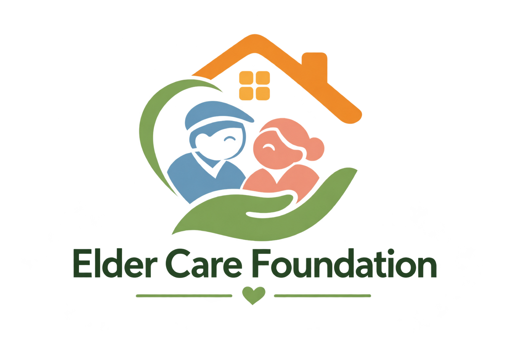

<p align="center">
  <a href="https://lichang1125.github.io/elder-care-foundation/">
    <picture>
      <source media="(prefers-color-scheme: dark)" srcset="public/images/elder-care-foundation-logo.jpg">
      
    </picture>
  </a>
</p>

<h1 align="center">Elder Care Foundation</h1>
<p align="center"><strong>Life is better, together.</strong></p>
<p align="center">Practical support · Meaningful connection · Everyday dignity</p>

<p align="center">
  <a href="https://lichang1125.github.io/elder-care-foundation/"><strong>Visit the website ↗</strong></a>
  &nbsp; · &nbsp;
  <a href="https://lichang1125.github.io/elder-care-foundation/about/">Our mission</a>
  &nbsp; · &nbsp;
  <a href="https://lichang1125.github.io/elder-care-foundation/our-work/">Explore support</a>
  &nbsp; · &nbsp;
  <a href="https://lichang1125.github.io/elder-care-foundation/events/">Community events</a>
</p>

---

## A digital home for care and connection

**We designed this promotional website for Elder Care Foundation**, a community-focused organization in Weihai supporting older adults and their families. The website brings its purpose, services and opportunities to participate into one welcoming digital experience.

Our design connects a simple message — growing older should not mean growing apart — with clear paths to explore support, discover activities, volunteer and learn about giving. It is intended for older residents, family members, community volunteers and prospective supporters.

<table>
<tr>
<td width="52%"></td>
<td width="48%">
<h3>Rooted in Weihai.<br>Here for one another.</h3>
<p>A warm, human-centred identity inspired by coastal community life. Forest green, soft sage, cream and apricot provide a calm setting for stories, services and practical next steps.</p>
<p><strong>Designed around people:</strong> readable typography, clear navigation, generous spacing and layouts that adapt to desktop and mobile screens.</p>
</td>
</tr>
</table>

## Mission & vision

| Our mission | Our vision |
| :--- | :--- |
| Make everyday life easier and more connected for older adults through practical, non-clinical support. | A Weihai where growing older never means facing life alone, with families, volunteers and local organizations contributing to a caring community. |

The website expresses three principles that guide the foundation’s approach:

- **Listen first.** Begin with the person’s priorities, preferences and everyday routine.
- **Protect independence.** Support people in making their own choices and staying involved.
- **Follow through.** Make the next step clear, agree a plan and keep care connected.

## Three ways to support everyday life

<table>
<tr>
<td width="33%"></td>
<td width="33%"></td>
<td width="33%"></td>
</tr>
<tr>
<td><strong>Accompanied transport</strong><p>A familiar face for the outward journey, support during an appointment and a planned return home.</p></td>
<td><strong>Nutrition assistance</strong><p>Practical help with food access and everyday nourishment, shaped around individual preferences.</p></td>
<td><strong>Everyday guidance</strong><p>Patient help with forms, useful information and connections to appropriate local resources.</p></td>
</tr>
</table>

[Explore the service approach →](https://lichang1125.github.io/elder-care-foundation/our-work/)

## Explore the website

| Page | What visitors can discover |
| :--- | :--- |
| [Home](https://lichang1125.github.io/elder-care-foundation/) | The foundation’s identity, service introductions and a rotating collection of care journeys. |
| [About](https://lichang1125.github.io/elder-care-foundation/about/) | Mission, vision, principles, Weihai’s ageing context and prospective community connections. |
| [Our work](https://lichang1125.github.io/elder-care-foundation/our-work/) | Detailed service pathways, the support available and how to take the next step. |
| [Impact](https://lichang1125.github.io/elder-care-foundation/impact/) | Annual ambitions, dated organizational records and an interactive volunteer-hours calculator. |
| [Events](https://lichang1125.github.io/elder-care-foundation/events/) | Upcoming activities, location and month filters, keyword search, event details and registration of interest. |
| [News](https://lichang1125.github.io/elder-care-foundation/news/) | Community notes, service perspectives and articles organized by theme. |
| [Get involved](https://lichang1125.github.io/elder-care-foundation/get-involved/) | Ways to give time, bring a team, plan a contribution and discover donor gifts. |
| [Contact](https://lichang1125.github.io/elder-care-foundation/contact/) | Service enquiries, volunteering interests, collaboration topics and practical questions. |

## An experience that invites participation

**Discover → Understand → Take part**

- **Explore before registering.** Visitors open an activity’s introduction, date and location before choosing to register their interest.
- **Find a relevant gathering.** Search activities and places, filter by month, or browse the wider organizational calendar.
- **See care in context.** The homepage carousel presents service journeys, with manual controls, pause and reduced-motion support.
- **Understand the numbers.** Annual goals and dated records are distinguished; a calculator shows how recurring volunteer commitments could add up.
- **Move comfortably between screens.** Responsive layouts, a mobile menu, visible focus states and direct page links support browsing on different devices.
- **Stay connected to information.** Public activity summaries can load from the organization’s Oracle APEX calendar, with a dated fallback when the feed is unavailable.

## Stories that keep kindness going

The **Maui and ChaoFeng** storybook and video collection are presented as thank-you gifts for supporters. Their artwork gives the participation page a distinctive visual focus and introduces a shared story across both formats.

<table>
<tr>
<td width="50%"></td>
<td width="50%"></td>
</tr>
<tr>
<td align="center"><strong>Maui and ChaoFeng</strong><br>Storybook</td>
<td align="center"><strong>Maui and ChaoFeng</strong><br>Video collection</td>
</tr>
</table>

[Discover ways to get involved →](https://lichang1125.github.io/elder-care-foundation/get-involved/)

## Thoughtful communication

The website presents care with respect for independence and privacy. Service journeys describe how support can work; community images are illustrations. Annual goals are identified as ambitions, while organizational records include their scope and reference date. Potential community connections are presented separately from confirmed partnerships.

<details>
<summary><strong>Current visitor interactions</strong></summary>

Registration of interest is saved on the visitor’s device and requires separate confirmation from the organizer. Enquiries can be downloaded as local drafts. The contribution journey does not process payments. Storybook and video covers are visible; the full works are not publicly accessible through the website.

</details>

<details>
<summary><strong>For website maintainers</strong></summary>

### Technology

React provides reusable page components, Vite handles asset compilation, and CSS defines the responsive visual system. A Node.js server supports local development and the existing local API. The public calendar uses approved Oracle APEX summaries.

### Local development

```sh
npm ci
npm run dev
```

Open `http://localhost:5173`.

### Validation and publishing

```sh
npm test
npm run build:pages
```

The publishing workflow updates the website from `main`. Each of the eight pages has a dedicated entry document for direct links and refreshes. The local production version uses `npm run build` followed by `npm start`.

### Repository guide

| Location | Purpose |
| :--- | :--- |
| `src/pages/` | The eight website pages and shared sections. |
| `src/components/` | Events, service journeys, forms, motion and dialogs. |
| `src/content.js` · `src/news.js` | Service, activity and editorial content. |
| `public/images/` | Brand identity, service illustrations and gift artwork. |
| `server/` | Local API and registration handling. |
| `scripts/` | Publishing preparation and compatibility checks. |

Private records, credentials and internal database scripts are excluded. Brand and artwork rights remain with their respective owners; this repository does not grant a reuse license for those assets.

</details>

<details>
<summary><strong>中文项目介绍</strong></summary>

这是我们为 **Elder Care Foundation** 设计的组织宣传网站，以威海社区长者及其家庭为中心，集中介绍组织的使命愿景、服务方向、社区活动与参与方式。

网站围绕“让长者的日常生活更便利、更有联结”展开，通过陪伴出行、营养协助和日常事务指导三个服务方向，帮助访客理解组织的工作。设计采用森林绿、鼠尾草绿、奶油白与暖杏色，配合清晰的文字层级和适配手机的布局，营造温暖、平静、易于浏览的阅读体验。

访客可以了解服务、查看活动详情后登记参与意向、阅读社区文章、探索志愿服务与团队合作，并浏览 **Maui and ChaoFeng** 绘本和视频赠品介绍。网站同时以明确的口径区分年度目标与已有记录，让组织的愿景、行动与信息呈现相互呼应。

</details>

---

<p align="center"><strong>Everyday support. Lasting connection.</strong><br>Designed for Elder Care Foundation · Weihai</p>
<p align="center"><a href="https://lichang1125.github.io/elder-care-foundation/"><strong>Explore the website ↗</strong></a></p>
